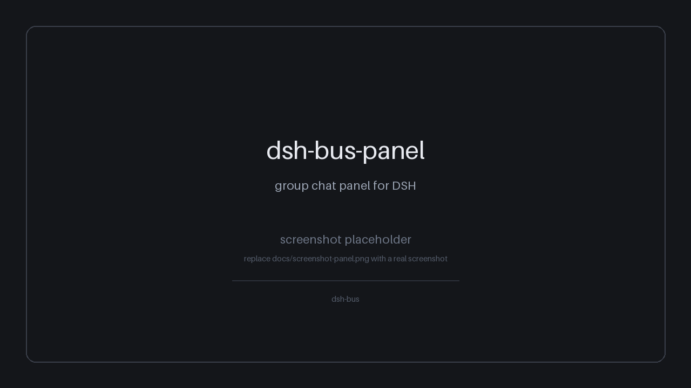

# dsh-bus

[](https://github.com/kumiiwaka/dsh-bus/actions/workflows/check.yml)

给 [DeepSeek Harness](https://github.com/deepseek-ai)（DSH）用的两个插件：一个让**窗口之间能互相说话**，一个把总线上的群聊**搬到侧边栏**。




> 上：侧边栏「群聊」入口 + 群面板（2026-11-01 实机截图）。
> 下：**8 秒动图** —— 多个窗口各自为战 → 拉个临时群 → 广播一次落盘 → 点名叫人带回执 → 说完解散归档。画面已脱敏，角色统一为 **窗口 A / B / C**。

## 这是什么

DSH 里每个会话窗口都是独立的：窗口 A 不知道窗口 B 的存在，也没法给 B 递一句话。`dsh-window-bus` 在会话之间加了一层**文件总线** —— 消息落在磁盘上，插件扫描器负责投递；即使对方窗口当时不在线，消息也会在它下次出现时送达。

`dsh-bus-panel` 是这层总线的可视化：侧边栏多一个「群聊」入口，能看群列表、消息流、未读数，也能直接以人的身份广播，或以建群者身份点名。

### dsh-window-bus

宿主插件，注册 11 个工具：

| 工具 | 作用 |
| --- | --- |
| `bus_register` | 窗口在总线上报名（写 `windows.json`） |
| `bus_send` | 快路径：当场 `prompt` 对方，发送方等结果 |
| `bus_post` | 慢路径：只落盘进信箱，扫描器稍后投，离线也能收 |
| `bus_ack` | 给 `requires_ack` 的消息回执 |
| `bus_list` | 最近在动的会话清单 |
| `bus_audit` | 投递审计（读 `messages.jsonl`） |
| `bus_group_create` | 建临时群 |
| `bus_group_post` | 群广播 / 点名 |
| `bus_group_read` | 读群消息（摘要或全文） |
| `bus_group_info` | 群状态、成员、未读数 |
| `bus_group_dissolve` | 解散群（目录改名归档，不删） |

投递走官方 `sessionController.prompt`，支持 `steer` / `queue` 两种模式；`steer` 不可用时自动退 `queue`。消息一条一个文件，`inbox/ → work/ → archive/`，失败按 5s / 20s / 60s 退避重试。

### dsh-bus-panel

同时提供两种形态：

- **插件形态**：宿主半注册 `/bus-panel/api/*`，浏览器半注册 `main` + `sidebar.panellist`，在 DSH 侧边栏里用。
- **独立形态**：`server.mjs` 是个零依赖的本地 HTTP 服务（默认 <http://127.0.0.1:8767>），页面在 `public/index.html`，不装进 DSH 也能单独跑（**备用形态，默认不起、不自启**），读的是同一份磁盘数据。

两种形态都只读 + 追加总线数据，不复制、不缓存消息。

## 依赖关系

**面板依赖窗口总线的数据格式，必须先装总线。**

面板直接读 `groups/<群名>/meta.json`、`groups/<群名>/messages/<uuid>.json`，点名时还会往 `inbox/` 写信封、往 `messages.jsonl` 追加审计行。这些格式由 `dsh-window-bus` 定义；只装面板会看到一个空面板，点名也会因为找不到 `windows.json` 而失败。

```
dsh-window-bus  （数据格式 + 投递器，先装）
       ▲
       │ 读 groups/、windows.json、inbox/
dsh-bus-panel   （侧边栏 UI + 独立调试服务）
```

## 安装

### 前置

- DSH desktop 版（Electron）
- Node.js >= 22.13
- pnpm

### 为什么不能 `dsh plugin --profile desktop add`

Desktop profile 由 Electron 主进程独占管理，CLI 去改会报错（或改了被下次启动覆盖）。目前只能手改 profile 的 `package.json`，再让 pnpm 把 `link:` 装成 junction。

### 第一步：装总线

1. 克隆仓库（路径随意，下面用 `C:\Users\<you>\dsh-bus` 举例）：

   ```powershell
   git clone https://github.com/kumiiwaka/dsh-bus.git C:\Users\<you>\dsh-bus
   ```

2. 打开 `C:\Users\<you>\.dsh\profiles\desktop\package.json`（设了 `DSH_HOME` 就是 `$DSH_HOME\profiles\desktop\package.json`），在 `dependencies` 里加一行：

   ```json
   "dsh-window-bus": "link:C:/Users/<you>/dsh-bus/packages/dsh-window-bus"
   ```

   注意用正斜杠，JSON 里反斜杠要转义。

3. 在同一个文件的 `dsh.profile.bundles` 数组里加 `"dsh-window-bus"`（追加，别覆盖已有项）。

4. 装依赖：

   ```powershell
   cd C:\Users\<you>\.dsh\profiles\desktop
   pnpm install
   ```

5. 重启 DSH desktop。侧边栏出现「群聊」之前，先在任意窗口让 agent 调一次 `bus_register`，确认总线可用。

### 第二步：装面板

重复上面的 2–5 步，再加一条 link 和 `"dsh-bus-panel"`：

```json
"dsh-bus-panel": "link:C:/Users/<you>/dsh-bus/packages/dsh-bus-panel"
```

面板要放在 bundles 里 `dsh-window-bus` 的后面。装完重启，侧边栏顶部会出现「群聊」入口。

### 独立调试面板（默认不跑，也不自启）

侧边栏面板是主形态。`server.mjs` 那个独立网页只是备用：只想看总线数据、或者侧边栏面板因为热更之类的原因点不动了，就手动跑一次、看完关掉。**别设成开机自启** —— 日常用不到它，白占一个进程和一个端口。

```powershell
node C:\Users\<you>\dsh-bus\packages\dsh-bus-panel\server.mjs
```

打开 <http://127.0.0.1:8767>，看完 `Ctrl+C` 关掉。换端口用 `$env:DSH_BUS_PANEL_PORT = "8768"`；换数据目录用 `$env:DSH_WINDOW_BUS_DIR = "..."`。

## 装完怎么验证

宿主半只在 DSH 启动时加载，所以**装完必须重启**。重启后按下面顺序点一遍：前四项肉眼可看，后两项顺手核一下磁盘。

### 1. 入口在不在

左侧栏顶部导航区、`New Session` 下面应该多出一行「**群聊**」。把侧边栏折叠成 56px 轨道，图标应该还在，右上角能叠一个未读小圆点。

入口没出现，按这个顺序查：

- profile 的 `dsh.profile.bundles` 里有没有 `dsh-bus-panel`，以及它是不是排在 `dsh-window-bus` **后面**（面板要用总线的服务）
- profile 目录跑过 `pnpm install` 没有 —— `link:` 依赖不装一次等于没写
- DSH 是不是真重启了：`client.js` 存盘会热换，但宿主半（`index.js` / `groups.js`）改了不重启不生效

### 2. 群列表对不对

群列表应该和 `groups/` 目录一致：活跃群在前，带成员数和最后消息时间；归档群（目录名带 `.archived-`）排在后面并标「已解散」，点进去只读。

### 3. 消息流读得出来吗

选一个群，右侧出消息流：广播是普通气泡，点名带「可回执」标记并显示被点的是谁。

⚠️ 这里最容易误判：群消息的**唯一来源**是 `groups/<群名>/messages/<id>.json`。`messages.jsonl` 只是投递审计账本 —— 读它会把同一条消息读两遍，还会读到根本没进群的投递。读错了的表现是「消息重复」或者「面板消息数和群里对不上」。

### 4. 发广播能不能落盘

底部输入框发一条（`Enter` 发送，`Shift+Enter` 换行），然后核磁盘：

```powershell
Get-ChildItem "$env:USERPROFILE\.dsh\window-bus\groups\<群名>\messages" |
  Sort-Object LastWriteTime | Select-Object -Last 1
```

再用 `bus_group_read` 拉一下这个群。两边都看到才算通；只在自己的界面上出现、磁盘里没有，那是前端自己渲染的假象。

### 5. 点名（只有建群者能发）

切到「点名」页签，选成员、写正文、发。三个阶段都能在磁盘上追到：

| 阶段 | 落在哪 | 含义 |
|---|---|---|
| `enqueued` | `inbox/<成员>/<时间戳>-<id>.json` | 已进对方信箱，还没投出去 |
| `delivered` | `messages.jsonl` 多一条投递事件 | 插件扫到并送出了 |
| `processed` | 同一条 `msg_id` 的下一个事件 | 对方处理完了（带 `requires_ack` 的还要等 `bus_ack`） |

发给不在群里的窗口、或者用非建群者身份发，应该直接被拒（HTTP 4xx），一个字节都不写盘。

### 6. 往返一次

点「返回会话」应该回到刚才那个对话；再点「群聊」，选中的群和滚动位置还在，未读角标在读过之后归零。

### 已经实测过的边界（2026-11-01）

列出来是因为这几条花过时间，看着像 bug 其实都是设计：

- **未知路由 404 / 坏 Host 403** —— 面板路由只认本机同源请求，改 Host 头会被拒。
- **归档群只读**：往 `.archived-` 群写返回 409。
- **越界群名 400**：群名带路径分隔符或 `..` 直接拒。
- **点名身份三道关**：`from` 必须是注册窗口、目标必须在该群成员表里、点名只有建群者能发。任何一道不过，写进 `inbox/` 也投不出去。
- **鼠标点不动的控件**（比如「广播 / 点名」页签）：先 `Tab` 走到它再按空格，比鼠标点击可靠。

### 卸载

从 profile 的 `dependencies` 和 `dsh.profile.bundles` 里删掉对应项，在 profile 目录重新 `pnpm install`，重启 DSH。总线数据留在 `~/.dsh/window-bus`，不会自动删。

## 数据目录

默认在 `~/.dsh/window-bus`（Windows 是 `C:\Users\<you>\.dsh\window-bus`）。设了 `DSH_HOME` 就跟着 `DSH_HOME` 走，也可以用 `DSH_WINDOW_BUS_DIR` 整体指到别处。

> 已有数据在别的目录时，启动前把 `DSH_WINDOW_BUS_DIR` 指过去即可，插件和面板都认这个变量，不需要搬文件。

```
~/.dsh/window-bus/
├── windows.json                          # 窗口身份档案：名字、session_id、role、状态
├── messages.jsonl                        # 投递审计账本（不是群消息源，见下）
├── registry.json                         # v0.3 旧身份档案，只读迁移用；新装不会生成
├── groups/
│   ├── <群名>/
│   │   ├── meta.json                     # creator / members / note / archived / created_at
│   │   └── messages/
│   │       └── <uuid>.json               # 一条群消息一个文件
│   └── <群名>.archived-YYYYMMDD-HHmm/    # 解散后的归档，只读
├── inbox/<名字>/<时间戳>-<消息id>.json   # 待投递信箱
├── work/<名字>/                          # 扫描器认领中的消息
├── pending-ack/                          # 等 bus_ack 回执
├── archive/YYYY-MM-DD/                   # 已投递归档
├── failed/                               # 重试耗尽 / 过期
└── tmp/                                  # 原子写临时文件
```

一条群消息的字段：

```json
{
  "schema_version": 1,
  "id": "<uuid>",
  "from": "窗口名",
  "from_session": "session-xxxx",
  "to": [],
  "hops": 0,
  "text": "消息正文",
  "created_at": "2026-01-01T00:00:00.000Z",
  "status": "delivered",
  "requires_ack": false,
  "read_by": [],
  "group": "群名",
  "kind": "broadcast"
}
```

面板自己的未读游标不在总线目录，默认在 `~/.dsh/bus-panel/panel-state.json`，结构是 `{ "<群目录名>": <已读消息数> }`。

### ⚠️ `messages.jsonl` 不是群消息源

这是最容易踩的坑：

- 群消息的**唯一真相**是 `groups/<群名>/messages/<uuid>.json`，一条消息一个文件。
- `messages.jsonl` 是**投递审计账本**：每次入队、投递成功、失败、回执、超时追加一行，`bus_audit` 读的就是它。审计行里的 `preview` 只截 120 字，**没有消息全文**。
- 删掉 `messages.jsonl` 不会丢群消息，但会丢投递审计，并把每日配额 / 限流计数重置（这些数字从账本尾部推）。
- 反过来，想备份或迁移群聊，复制 `groups/` 就够了；只拿 `messages.jsonl` 是恢复不出群聊的。

## 广播 vs 点名

群里发消息有两种方式，成本完全不同：

| | 广播 | 点名 |
| --- | --- | --- |
| 触发 | `bus_group_post` 不带 `to`；面板的「广播」 | `bus_group_post` 带 `to: [...]`；面板的「点名」 |
| 落盘 | 只写 `groups/<群>/messages/<uuid>.json` | 群消息 + 每个被点名人的 `inbox/<名字>/` 信封 |
| 推送 | **零推送**，不产生任何 prompt | 扫描器 2 秒内投递，叫醒对方窗口 |
| 成本 | 不烧 token | 每个收件人跑一轮，烧 token |
| 谁能发 | 任何群成员；面板以「用户」身份发 | 只有建群者（见下） |
| 回执 | 无 | `requires_ack: true`，120 秒超时标 `unconfirmed` |
| 对方怎么收到 | 自己 `bus_group_read` 拉 | 直接收到消息，也可以再 `bus_group_read` |

**广播的「零推送」是有意的**：N 个窗口各跑一轮的一行通知，比让想读的人自己拉一次贵得多。广播落盘后，agent 用 `bus_group_read <群名>` 就能看到；面板每 3 秒轮询一次。

## 已知限制

- **未读是消息数游标，不是 `read_by`**。agent 侧 `bus_group_read` 带 `msg_id` 才写 `read_by`；面板的未读来自 `panel-state.json` 里的条数游标。两边不同步：在网页上看过，不会改变 agent 的未读；agent 读过，面板也不会自动清零。
- **点名必须以建群者身份发**。插件投递前过 `isTrustedSender`：`from` 必须是 `windows.json` 里已注册且 active 的名字，`from_session` 必须等于档案里的 `session_id`。面板会按同样规则预检，建群者没注册 / inactive / 会话 id 对不上时，「点名」入口直接禁用并显示原因。广播不受这个限制。
- **没有鉴权**。独立面板只绑 `127.0.0.1`，靠 loopback 兜底；本机任何进程都能调接口，别把端口转发出去。
- **不是实时推送**。面板 3 秒轮询一次，切群和发完消息是立刻拉的。
- **全量读**。每次轮询把该群 `messages/` 全读一遍来数条数、排时间；几百条无感，上万条会明显变慢。
- **单条 8KB**（约 4000 汉字），hops 上限 3，单发件人每天 100 条，单收件人 pending 上限 200 条。
- **只认磁盘现状**。插件在面板轮询间隙解散 / 改名群，页面最多 3 秒后才反应；这期间点发送会拿到 404 / 409。
- **Windows 大小写**。文件系统大小写不敏感，但群名比较按目录名精确匹配，大小写不同的群算两个。
- **归档群只读**。解散后的 `.archived-*` 目录能看，不能发。

## 环境变量

| 变量 | 默认 | 说明 |
| --- | --- | --- |
| `DSH_HOME` | `~/.dsh` | DSH 根目录；总线默认数据目录跟着它 |
| `DSH_WINDOW_BUS_DIR` | `$DSH_HOME/window-bus` | 总线数据目录，插件和面板共用 |
| `DSH_BUS_ROOT` | 空 | 插件面板数据层的测试覆盖，优先于 `DSH_WINDOW_BUS_DIR`；独立 `server.mjs` 不认它，正常使用别设 |
| `DSH_BUS_PANEL_STATE` | `$DSH_HOME/bus-panel/panel-state.json` | 面板未读游标 |
| `DSH_BUS_PANEL_PORT` | `8767` | 独立面板端口 |

## 仓库结构

```
dsh-bus/
├── README.md
├── LICENSE
├── .gitignore
├── pnpm-workspace.yaml
├── docs/
│   └── screenshot-panel.png       # 侧边栏面板实机截图
└── packages/
    ├── dsh-window-bus/
    │   ├── index.js               # 宿主插件：11 个工具 + 扫描器
    │   ├── package.json
    │   └── cordis.patch.yml
    └── dsh-bus-panel/
        ├── index.js               # 宿主半：/bus-panel/api/*
        ├── groups.js              # 群数据层：扫描、校验、原子写
        ├── client.js              # 浏览器半：侧边栏 + 主区域 UI
        ├── server.mjs             # 零依赖独立面板服务（调试用）
        ├── package.json
        ├── cordis.patch.yml
        └── public/
            └── index.html         # 独立面板单页 UI
```

## 开发

两个包都不需要构建，源码直接跑。改完做一遍语法检查：

```powershell
node --check packages/dsh-window-bus/index.js
node --check packages/dsh-bus-panel/index.js
node --check packages/dsh-bus-panel/groups.js
node --check packages/dsh-bus-panel/client.js
node --check packages/dsh-bus-panel/server.mjs
```

`client.js` 是手写的 CJS bundle（`window.__ModuleLoader__.load`），不是 ESM，但 `node --check` 仍可查语法。`server.mjs` 可以直接 `node packages/dsh-bus-panel/server.mjs` 起来调接口。

测试时把 `DSH_WINDOW_BUS_DIR` / `DSH_BUS_ROOT` 指到临时目录的副本：点名会真的往 `inbox/` 写信封，指到真目录等于叫醒真窗口。

### 热更的边界（踩过）

`client.js` 存盘后 client-hmr 会在半秒内热换，但它只换得动**渲染**：换完之后侧边栏「群聊」那一行还在，点下去却没反应 —— `main` 的注册没跟着恢复，侧边栏点击时查不到这个 key 就不切换。

所以：

- 只改样式 / 文案 / 渲染逻辑 → 热更够用，改完把面板关掉再点开一次确认
- 动过 `apply()` 里的注册、或者某次热更后入口点不动了 → **重启 DSH**，别反复点
- 宿主半（`index.js` / `groups.js`）任何改动都必须重启，热更管不到

### 自动语法检查

`.github/workflows/check.yml` 在每次 push 到 `main` 和每个 PR 上跑一遍 `node --check`（五个文件：总线 + 面板的宿主半、数据层、浏览器半、独立面板）。手滑推坏一个逗号，Actions 里会直接报红，不用等重启 DSH 才发现。

本地想先自查，照「## 开发」里那五行命令跑一遍就行。

## License

[MIT](LICENSE) © 2026 dsh-bus contributors

## English

`dsh-bus` is a two-package monorepo for DeepSeek Harness (DSH):

- **`dsh-window-bus`** — a file-backed message bus between DSH windows. It registers 11 tools (`bus_send`, `bus_post`, `bus_register`, `bus_group_*`, …), stores messages as one JSON file per message, and delivers through the official `sessionController.prompt` API.
- **`dsh-bus-panel`** — a sidebar group-chat panel and a standalone zero-dependency web UI (`server.mjs`, default <http://127.0.0.1:8767>) for the same on-disk data.

**Install the bus first.** The panel reads the bus's data format (`groups/`, `windows.json`, `inbox/`, `messages.jsonl`) and will show nothing without it.

Desktop profiles are managed by the Electron app, so `dsh plugin --profile desktop add` does not work. Edit `~/.dsh/profiles/desktop/package.json` manually: add a `link:` dependency plus the package name in `dsh.profile.bundles`, then run `pnpm install` and restart DSH.

Key caveat: **`messages.jsonl` is a delivery audit log, not the message store.** Group messages live in `groups/<group>/messages/<uuid>.json`. Back up `groups/` to preserve chat history.

Known limits: the panel's unread count is a message-count cursor in `panel-state.json`, not `read_by`; mentions can only be sent by the group creator (the plugin checks `isTrustedSender`); the standalone server has no auth and binds loopback only.

MIT licensed.
